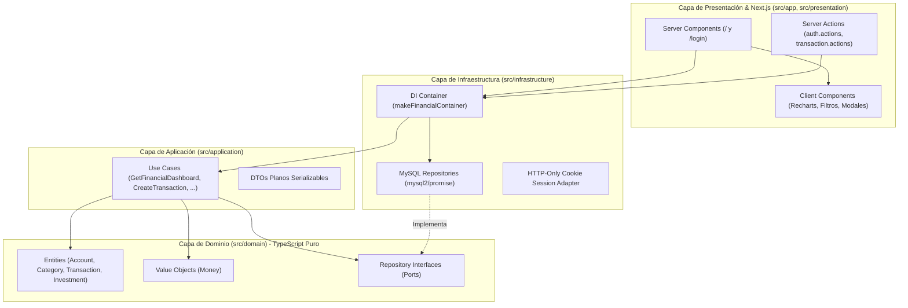

# 01. Arquitectura del Sistema (Clean Architecture)

## 1. Principios Arquitectónicos
El **Gestor de Finanzas Personales e Inversiones (`FinanzasPro`)** está diseñado bajo los principios de **Clean Architecture** y **Separación de Responsabilidades (SoC)** sobre **Next.js (App Router)** y **TypeScript estricto**.

La **Regla de Dependencia** se aplica de forma inquebrantable: todas las dependencias de código fuente apuntan exclusivamente hacia adentro (hacia la capa de **Dominio**).

---

## 2. Estructura de Directorios (`src/`)

| Capa | Ruta | Responsabilidad | Restricciones |
| :--- | :--- | :--- | :--- |
| **Dominio** | `src/domain/` | Entidades (`Account`, `Category`, `Transaction`, `Investment`), Value Object [`Money`](../src/domain/value-objects/Money.ts), errores de dominio y puertos (`I*Repository`). | Prohibido importar React, Next.js, drivers SQL o librerías de UI. |
| **Aplicación** | `src/application/` | Casos de Uso puros (`GetFinancialDashboardUseCase`, `CreateTransactionUseCase`, etc.) y DTOs serializables. | Orquesta entidades y puertos del dominio; agnóstico a MySQL y React. |
| **Infraestructura** | `src/infrastructure/` | Pool de conexiones `mysql2/promise` hacia el contenedor `react_nextjs_gestor_finanzas`, repositorios SQL con soporte transaccional ACID y contenedor de inyección de dependencias. | Implementa las interfaces de `src/domain/repositories/`. |
| **Presentación** | `src/presentation/` y `src/app/` | Rutas de Next.js App Router, Server Actions validadas con `Zod`, Server Components y Client Components interactivos con `recharts` y `lucide-react`. | Sin lógica de negocio compleja; delega en los Casos de Uso. |
