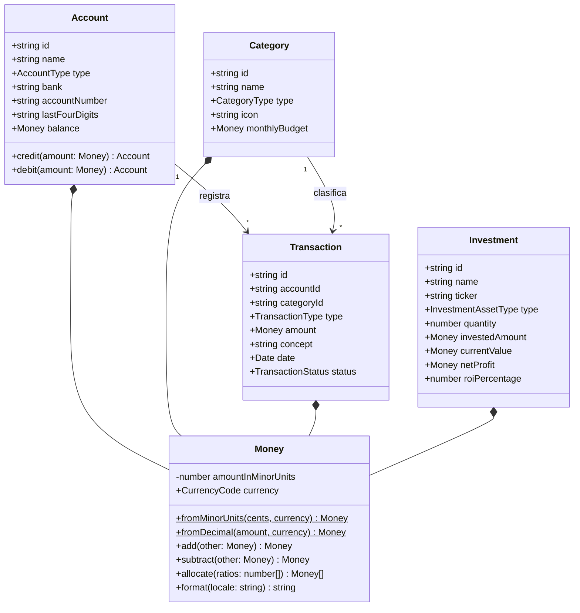
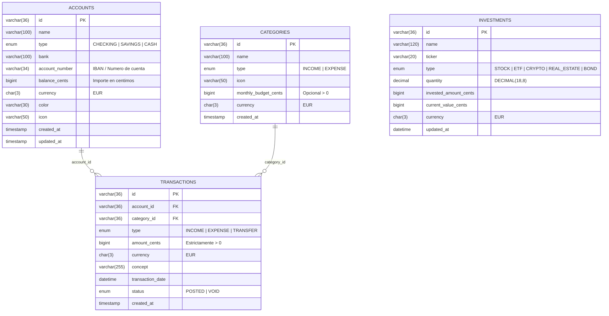

# 02. Modelo de Dominio y Esquema Entidad-Relación

## 1. Regla Monetaria e Invariantes Contables (`financial-domain-modeling`)
1. **Unidades menores enteras (`Money` VO)**: Todos los importes monetarios se almacenan en base de datos en céntimos enteros (`BIGINT`) junto con el código de divisa ISO 4217 (`EUR`) y se operan en memoria mediante el Value Object inmutable `Money`.
2. **Prohibición de importe cero**: Ninguna entidad `Transaction` puede instanciarse ni persistirse con `amount.minorUnits <= 0`.
3. **Presupuestos positivos**: Toda categoría con presupuesto mensual definido (`monthlyBudget`) exige un límite estrictamente mayor que `0` céntimos.
4. **Actualización atómica de saldos**: Al registrar un movimiento (`INCOME` o `EXPENSE`), la inserción en `transactions` y la actualización de `accounts.balance_cents` se ejecutan dentro de una misma transacción ACID en MySQL (`BEGIN` / `COMMIT` / `ROLLBACK`).

---

## 2. Diagrama de Clases del Dominio (`classDiagram`)

---

## 3. Esquema Entidad-Relación en MySQL 8.0 (`erDiagram`)

