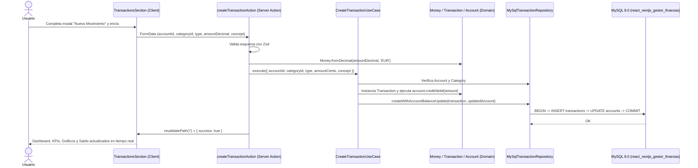

# Feature: MVP Gestor de Finanzas Personales e Inversiones

> **Estado:** Implementado
> **Última actualización:** 2026-10-18

## 1. Propósito Técnico
Proporcionar una plataforma integral de gestión de patrimonio personal e inversiones que consolide cuentas bancarias/efectivo, categorización de ingresos y gastos, analítica visual de los últimos 6 meses y seguimiento de cartera de inversión (`ETF`, `STOCK`, `CRYPTO`, `BOND`), junto con un flujo de autenticación ligera ("Fake Login").

## 2. Modelo de Dominio e Invariantes
- **`Money`**: Opera en céntimos enteros (`minorUnits`) con validación `Number.isSafeInteger` y reparto exacto de restos (`allocate`).
- **`Account`**: Representa cuentas corrientes (`CHECKING`), ahorro (`SAVINGS`) y efectivo (`CASH`), exponiendo transiciones inmutables `credit(Money)` y `debit(Money)`.
- **`Transaction`**: Valida `amount.minorUnits > 0` y estado `POSTED | VOID`.
- **`Investment`**: Calcula en dominio `netProfit` (`currentValue.subtract(investedAmount)`) y `roiPercentage`.

## 3. Casos de Uso (Inputs / Outputs)
- **`GetFinancialDashboardUseCase`**:
  - **Input**: `referenceDate?: Date`
  - **Output**: `FinancialDashboardDTO` (Patrimonio Neto Total, Liquidez Total, Valor y ROI de Inversiones, Balance y Tasa de Ahorro del mes actual, Serie de 6 meses de Ingresos vs Gastos, Gastos por Categoría y Distribución por Clase de Activo).
- **`CreateTransactionUseCase`**:
  - **Input**: `CreateTransactionInput` (`accountId`, `categoryId`, `type`, `amountCents`, `concept`, `date`)
  - **Output**: `{ transactionId: string, newBalanceCents: number }`
- **`GetAccountsUseCase` / `GetCategoriesUseCase` / `GetTransactionsUseCase` / `GetInvestmentsUseCase`**:
  - **Output**: Colecciones de DTOs planos listos para hidratar Server y Client Components.

## 4. Diagrama de Secuencia (Mermaid)

## 5. Infraestructura y Persistencia
- Contenedor Docker `mysql:8.0` con `container_name: react_nextjs_gestor_finanzas`.
- Inicialización automática mediante `/docker-entrypoint-initdb.d` (`01-schema.sql` y `02-seed.sql`) y script manual `npm run db:seed` (`scripts/seed.mjs`).
- Sesión de usuario gestionada mediante cookie HTTP-only `gf_session_user`.

## 6. Historial Incremental de Cambios
- **2026-10-18**: Implementación completa del MVP (Docker MySQL 8.0, Dominio con `Money`, Casos de Uso, Repositorios MySQL, Fake Login, Dashboard y Gráficos Recharts).
